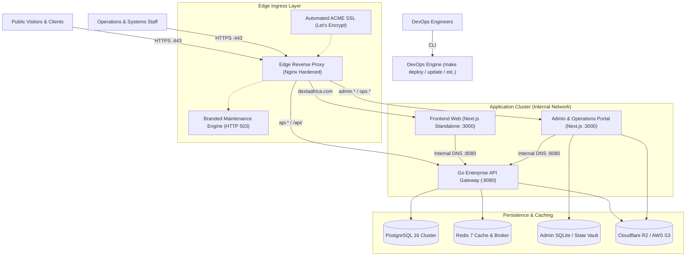

# Dexta Africa Enterprise Production Infrastructure & DevOps

Production-grade containerized infrastructure and automated DevOps orchestration for **Dexta Africa**: connecting the Next.js Frontend Web Platform, the Enterprise Operations & Systems Admin Command Portal, and the Go Core Enterprise Backend API into a unified, zero-trust, high-performance edge cluster.

---

## Architecture Topology



---

## Key Features

1. **One-Command Production Deployment (`make deploy`)**:
   - Automated environment validation and preflight security verification.
   - Multi-stage Docker builds with BuildKit caching.
   - Automated PostgreSQL and SQLite database migrations.
   - Automated Let's Encrypt SSL/TLS certificates with zero-touch renewals.
   - Comprehensive container healthchecks before edge traffic routing.

2. **Rolling Zero-Downtime Updates (`make update`)**:
   - Automated pre-update database backup snapshot.
   - Git commit synchronization across infrastructure and services.
   - Pre-building updated images in the background while live containers serve traffic.
   - Graceful sequential container replacement with health probes.
   - Graceful Nginx reload (`nginx -s reload`) without dropping active connections.

3. **Enterprise Maintenance Mode (`make maintenance-on` / `make maintenance-off`)**:
   - Renders a bespoke, high-end Dexta Africa branded 503 maintenance page.
   - CIDR bypass whitelist (`MAINTENANCE_BYPASS_CIDR`) for internal engineering teams to access the site while the public sees maintenance.
   - Client-side auto-reconnect engine: silently pings server health in the background and auto-refreshes the browser the moment maintenance mode is turned off.

4. **Zero-Trust Hardened Security & Isolation**:
   - Minimal attack surface: Distroless & Alpine non-root execution (`nextjs:nodejs`, `nonroot:nonroot`).
   - Hardened Nginx edge with modern TLS 1.3 ciphers, HSTS, X-Frame-Options, CSP, and rate limiting zones.
   - All internal inter-service traffic stays inside isolated bridge network `dexta_network`.

5. **Automated Database Backups & Recovery (`make backup` / `make restore`)**:
   - Unified snapshot of PostgreSQL and Admin Portal SQLite state.
   - Compressed `.tar.gz` archives with automated 14-day retention rotation.
   - Interactive or one-click disaster recovery.

---

## Directory Layout

```text
infrastructure/
├── Makefile                      # Primary DevOps command center
├── docker-compose.yml            # Core production container orchestration
├── docker-compose.prod.yml       # Production resource limits & logging tuning
├── docker-compose.dev.yml        # Local development compose with hot reloading
├── .env.example                  # Master environment variable dictionary
├── docker/
│   └── nginx/
│       ├── Dockerfile            # Hardened Nginx edge image
│       ├── nginx.conf            # High-performance global config
│       ├── templates/            # Dynamic envsubst virtual host templates
│       ├── html/                 # Branded maintenance & error pages
│       └── maintenance/          # Maintenance flag state directory
├── scripts/
│   ├── deploy.sh                 # Initial production deployment runner
│   ├── update.sh                 # Rolling update runner
│   ├── maintenance.sh            # Maintenance mode switch
│   ├── backup.sh                 # Database backup runner with rotation
│   ├── restore.sh                # Database disaster recovery runner
│   ├── init-ssl.sh               # Let's Encrypt certificate bootstrapper
│   ├── setup-services.sh         # Service discovery and clone script
│   └── validate-env.sh           # Environment security preflight validator
├── backups/db/                   # Stored database backup archives
├── services/                     # Application repositories (Frontend, Admin, Backend)
└── .github/workflows/
    ├── ci.yml                    # Automated Docker & script lint CI
    └── deploy.yml                # Continuous Deployment via SSH on push to main
```

---

## Quickstart & Deployment Guide

### 1. Prerequisites on Production Host
- **OS**: Ubuntu 22.04+ / Debian 12 / Linux VPS (AWS EC2, DigitalOcean, Hetzner, etc.)
- **Docker**: Engine version 24.0+
- **Docker Compose**: Plugin version 2.20+
- **Make**: `apt install -y make` (or equivalent)
- **DNS**: A records pointing `dextaafrica.com`, `admin.dextaafrica.com`, `ops.dextaafrica.com`, and `api.dextaafrica.com` to your host IP.

### 2. Initial Setup

Clone the infrastructure repository onto your server:

```bash
git clone https://github.com/DextaAfrica/infrastructure.git /opt/dextaafrica/infrastructure
cd /opt/dextaafrica/infrastructure
```

Run setup to generate your `.env` configuration:

```bash
make setup
```

Edit `.env` and fill in your domain, PostgreSQL passwords, and application secrets:

```bash
nano .env
```

### 3. Deploy Production Stack

Run the single deployment command:

```bash
make deploy
```

The script will validate your environment, build containers, run database migrations, issue Let's Encrypt SSL certificates, launch the reverse proxy, and output active service URLs.

---

## Daily Operations Command Reference

| Command | Description |
| :--- | :--- |
| `make deploy` | Performs full initial production deployment and SSL issuance |
| `make update` | Executes rolling, zero-downtime update with safety backup |
| `make start` | Starts all stopped containers in detached mode |
| `make stop` | Gracefully stops all cluster services |
| `make restart` | Gracefully restarts all containers sequentially |
| `make status` | Displays container health, telemetry, ports, and maintenance state |
| `make logs` | Streams unified real-time logs across all services |
| `make logs service=backend` | Streams logs specifically for `backend` (or `frontend`, `admin-portal`, `reverse-proxy`) |
| `make maintenance-on` | Instantly activates branded HTTP 503 maintenance page |
| `make maintenance-off` | Instantly restores live traffic to all services |
| `make maintenance-status` | Checks current maintenance mode status |
| `make backup` | Creates timestamped, gzip-compressed database snapshot |
| `make restore file=<path>` | Restores PostgreSQL and SQLite state from a backup archive |
| `make ssl` | Manually triggers Let's Encrypt SSL provisioning or renewal |
| `make prune` | Cleans up orphaned containers, dangling images, and build cache |
| `make dev` | Starts local multi-service development cluster with hot reloading |

---

## Maintenance Mode Workflow

When conducting database schema alterations or major releases:

```bash
# 1. Turn on maintenance mode (public receives branded 503 page, engineer IPs bypass)
make maintenance-on

# 2. Run update or migrations safely
make update

# 3. Turn off maintenance mode (traffic restored, client browsers auto-reload)
make maintenance-off
```

---

## Automated Backups & Disaster Recovery

### Creating a Backup
```bash
make backup
```
Backups are archived into `backups/db/dexta_backup_YYYYMMDD_HHMMSS.tar.gz`. Automated retention keeps the last 14 days of backups.

### Restoring from Backup
```bash
make restore file=backups/db/dexta_backup_20261119_120000.tar.gz
```

---

## Continuous Deployment (CI/CD)

GitHub Actions workflow `.github/workflows/deploy.yml` triggers automatically whenever code is pushed to `main`.
Configure the following repository secrets in GitHub:
- `PROD_SERVER_HOST`: Production server IP / Hostname
- `PROD_SERVER_USER`: SSH user (e.g., `ubuntu` or `deploy`)
- `PROD_SSH_PRIVATE_KEY`: Ed25519 or RSA private key
- `PROD_DEPLOY_PATH`: Absolute path (e.g., `/opt/dextaafrica/infrastructure`)

---

## Security & Hardening Checklist
- [x] All application containers run as unprivileged, non-root users.
- [x] Distroless and Alpine base images minimizing CVE attack surface.
- [x] Automated rate limiting zones against brute-force and DDoS attacks.
- [x] Modern TLS 1.3 ciphers, HSTS preloading, and CSP headers.
- [x] Zero hardcoded domain names or secrets in codebase.
- [x] Encrypted, password-protected Redis broker and PostgreSQL connection pooling.
