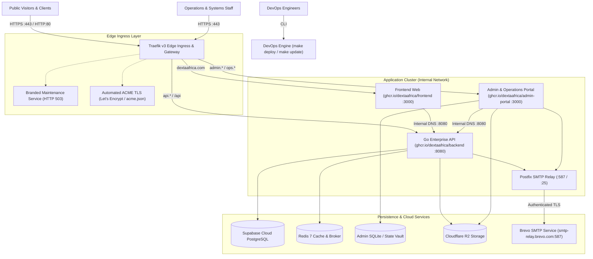

# Dexta Africa Enterprise Production Infrastructure & DevOps

Production-grade containerized infrastructure and automated CI/CD DevOps orchestration for **Dexta Africa**: connecting the Next.js Frontend Web Platform, the Enterprise Operations & Systems Admin Command Portal, and the Go Core Enterprise Backend API using **Traefik v3** Edge Ingress, **Postfix + Brevo** Mail Relay, and pre-built **GitHub Container Registry (GHCR)** images.

---

## Architecture Topology



---

## Continuous Delivery Pipeline & Image Pull Architecture

Images are compiled, security-scanned (Trivy), and published to GitHub Container Registry (**GHCR**) by each repository's CI/CD pipeline:
* **Frontend Web**: `ghcr.io/dextaafrica/frontend:latest`
* **Admin Portal**: `ghcr.io/dextaafrica/admin-portal:latest`
* **Core Backend**: `ghcr.io/dextaafrica/backend:latest`

When deploying on the production server, `make deploy` pulls the verified pre-built images in seconds without consuming server CPU or memory rebuilding bundles on the host.

---

## Deployment Lifecycle (`make deploy`)

When executing `make deploy`, the automated sequence runs:

1. **Pull Infrastructure Repository**:
   ```bash
   git pull --ff-only
   ```
2. **Enable Branded Maintenance Page**:
   ```bash
   docker compose -f docker-compose-prod.yml -f docker-compose-maintenance.yml --env-file .env.prod up -d --force-recreate maintenance
   ```
3. **Pull Latest Container Images**:
   ```bash
   docker compose -f docker-compose-prod.yml --env-file .env.prod pull api frontend admin
   ```
4. **Execute Database Migrations**:
   ```bash
   docker compose -f docker-compose-prod.yml --env-file .env.prod up migrate --exit-code-from migrate --abort-on-container-exit
   ```
5. **Rollout Microservices**:
   ```bash
   docker compose -f docker-compose-prod.yml --env-file .env.prod up -d redis traefik postfix api frontend admin
   ```
6. **Wait for Health Verification**:
   Polls container health checks up to 180s until `api`, `frontend`, and `admin` report healthy.
7. **Disable Maintenance Page**:
   ```bash
   docker compose -f docker-compose-prod.yml -f docker-compose-maintenance.yml --env-file .env.prod stop maintenance
   docker compose -f docker-compose-prod.yml -f docker-compose-maintenance.yml --env-file .env.prod rm -f maintenance
   ```
8. **Prune Dangling Images**:
   ```bash
   docker image prune -f
   ```
9. **Deploy Complete**.

---

## Directory Layout

```text
infrastructure/
├── Makefile                          # Primary DevOps command center
├── docker-compose-prod.yml           # Production stack (GHCR images, limits, healthchecks)
├── docker-compose-maintenance.yml    # Maintenance mode overlay (high-priority 503 router)
├── docker-compose.dev.yml            # Local development compose with hot reloading
├── .env.example                      # Master environment variable dictionary
├── .env.prod                         # Active production configuration file
├── docker/
│   ├── traefik/
│   │   ├── traefik.yml               # Traefik v3 static configuration
│   │   ├── dynamic/                  # Security headers, rate limiting & buffering
│   │   └── acme/                     # Let's Encrypt acme.json vault
│   ├── postfix/
│   │   ├── Dockerfile                # Postfix container
│   │   └── entrypoint.sh             # Brevo SASL authentication & relay bootstrap
│   └── maintenance/
│       ├── Dockerfile                # Lightweight maintenance web server
│       └── html/                     # Branded 503 maintenance page
├── scripts/
│   ├── wait-healthy.sh               # Health check verification probe (180s timeout)
│   ├── maintenance.sh                # Standalone maintenance mode controller
│   ├── backup.sh                     # Database backup runner
│   ├── restore.sh                    # Database restore runner
│   ├── init-ssl.sh                   # Traefik ACME permissions initializer
│   ├── setup-services.sh             # Service discovery and clone script
│   └── validate-env.sh               # Environment security preflight validator
└── backups/db/                       # Stored database backup archives
```

---

## Daily Operations Command Reference

| Command | Description |
| :--- | :--- |
| `make deploy` | Full zero-downtime deployment (pull infra, maintenance on, pull images, migrate, rollout, wait healthy, maintenance off, prune) |
| `make update` | Rolling update without maintenance page (pull infra, pull images, migrate, rollout, wait healthy, prune) |
| `make pull-images` | Manually pulls the latest `api`, `frontend`, and `admin` images from GHCR |
| `make migrate` | Runs the database migration container and exits upon completion |
| `make start` | Starts all production containers in detached mode |
| `make stop` | Gracefully stops all cluster services |
| `make restart` | Gracefully restarts all containers sequentially |
| `make status` | Displays container health, telemetry, ports, and resource usage |
| `make logs` | Streams unified real-time logs across all services |
| `make logs service=api` | Streams logs specifically for `api` (or `frontend`, `admin`, `traefik`, `postfix`) |
| `make maintenance-on` | Instantly activates branded HTTP 503 maintenance page via Traefik |
| `make maintenance-off` | Instantly restores live traffic to all services |
| `make backup` | Creates timestamped, gzip-compressed database snapshot |
| `make restore file=<path>` | Restores database state from a backup archive |
| `make prune` | Cleans up dangling images and unused Docker resources |
