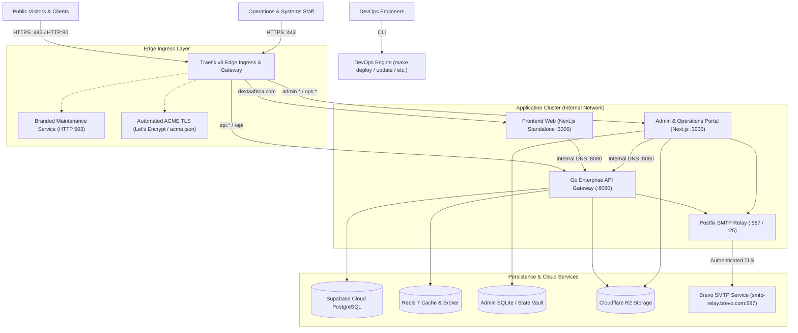

# Dexta Africa Enterprise Production Infrastructure & DevOps

Production-grade containerized infrastructure and automated DevOps orchestration for **Dexta Africa**: connecting the Next.js Frontend Web Platform, the Enterprise Operations & Systems Admin Command Portal, and the Go Core Enterprise Backend API using **Traefik v3** Edge Ingress and **Postfix + Brevo** Mail Relay.

---

## Architecture Topology



---

## Key Features

1. **Edge Ingress Gateway (Traefik v3)**:
   - **Automatic Let's Encrypt SSL/TLS**: Automated HTTP-01 challenge handling and certificate renewals stored in `acme.json`.
   - **Declarative Docker Label Routing**: Traefik automatically discovers containers, routes subdomains (`dextaafrica.com`, `admin.*`, `ops.*`, `api.*`), and enforces HTTP to HTTPS redirection.
   - **Enterprise Middlewares**: Compression (Gzip/Brotli), modern HSTS and security headers, rate limiting on APIs and logins, and large payload buffering for media uploads.
   - **HTTP/3 (QUIC) Support**: Pre-configured on UDP `:443`.

2. **Enterprise Email Infrastructure (Postfix + Brevo)**:
   - **Dedicated Postfix Mail Relay**: Decouples web and backend applications from direct external SMTP latency.
   - **Queue Durability**: Emails are queued locally (`postfix_spool` volume) with automated retries if external connectivity fluctuates.
   - **Brevo SMTP Relay**: Outbound delivery through Brevo (`smtp-relay.brevo.com:587`) with authenticated TLS and SASL credentials for maximum inbox deliverability.

3. **Enterprise Maintenance Mode Engine**:
   - High-end Dexta Africa branded 503 maintenance page with real-time background status pinging (`/api/health`) and auto-browser refresh upon restoration.
   - **Instant Toggle**: Managed via `make maintenance-on` and `make maintenance-off`.
   - **CIDR Bypass Whitelisting**: Allows developers and internal staff (`MAINTENANCE_BYPASS_CIDR`) to access the live site during maintenance while public visitors see the 503 page.

4. **One-Command Production Operations (`make deploy` / `make update`)**:
   - `make deploy`: Verifies environment, prepares services, boots Redis, Postfix, Traefik, runs database migrations, and brings up the full cluster.
   - `make update`: Rolling, minimal-downtime updates with automated safety database backups.

---

## Directory Layout

```text
infrastructure/
├── Makefile                      # Primary DevOps command center
├── docker-compose.yml            # Core production container orchestration
├── docker-compose.prod.yml       # Production resource limits & logging tuning
├── docker-compose.dev.yml        # Local development compose with hot reloading
├── .env.example                  # Master environment variable dictionary
├── .env-prod                     # Production environment configuration template
├── docker/
│   ├── traefik/
│   │   ├── traefik.yml           # Traefik v3 static configuration
│   │   ├── dynamic/              # Dynamic middlewares & maintenance routing
│   │   └── acme/                 # Let's Encrypt acme.json vault
│   ├── postfix/
│   │   ├── Dockerfile            # Postfix container
│   │   └── entrypoint.sh         # Brevo SASL authentication & relay bootstrap
│   └── maintenance/
│       ├── Dockerfile            # Lightweight maintenance web server
│       └── html/                 # Branded 503 maintenance page
├── scripts/
│   ├── deploy.sh                 # Production deployment runner
│   ├── update.sh                 # Rolling update runner
│   ├── maintenance.sh            # Maintenance mode switch
│   ├── backup.sh                 # Database backup runner
│   ├── restore.sh                # Database restore runner
│   ├── init-ssl.sh               # Traefik ACME permissions initializer
│   ├── setup-services.sh         # Service discovery and clone script
│   └── validate-env.sh           # Environment security preflight validator
├── backups/db/                   # Stored database backup archives
└── services/                     # Application repositories (Frontend, Admin, Backend)
```

---

## Quickstart & Deployment Guide

### 1. Configure Production Environment

Copy your production settings:

```bash
cp .env-prod .env
```

Open `.env` and fill in:
- Your **Supabase Database Password** in `DATABASE_URL`.
- Your **Brevo SMTP credentials** in `BREVO_SMTP_USER` and `BREVO_SMTP_KEY` (from [Brevo SMTP & API Keys](https://app.brevo.com/settings/keys/smtp)).

### 2. Deploy Production Stack

Run the single deployment command:

```bash
make deploy
```

Traefik will start on ports 80/443, request Let's Encrypt certificates, verify container health, and launch the Postfix mail relay and application stack.

---

## Daily Operations Command Reference

| Command | Description |
| :--- | :--- |
| `make deploy` | Performs full initial production deployment and SSL issuance |
| `make update` | Executes rolling, zero-downtime update with safety backup |
| `make start` | Starts all stopped containers in detached mode |
| `make stop` | Gracefully stops all cluster services |
| `make restart` | Gracefully restarts all containers sequentially |
| `make status` | Displays container health, telemetry, ports, and maintenance state |
| `make logs` | Streams unified real-time logs across all services |
| `make logs service=traefik` | Streams logs specifically for `traefik` (or `backend`, `frontend`, `admin-portal`, `postfix`) |
| `make maintenance-on` | Instantly activates branded HTTP 503 maintenance page via Traefik |
| `make maintenance-off` | Instantly restores live traffic to all services |
| `make maintenance-status` | Checks current maintenance mode status |
| `make backup` | Creates timestamped, gzip-compressed database snapshot |
| `make restore file=<path>` | Restores database state from a backup archive |
| `make ssl` | Verifies Traefik Let's Encrypt ACME permissions |
| `make prune` | Cleans up orphaned containers, dangling images, and build cache |
