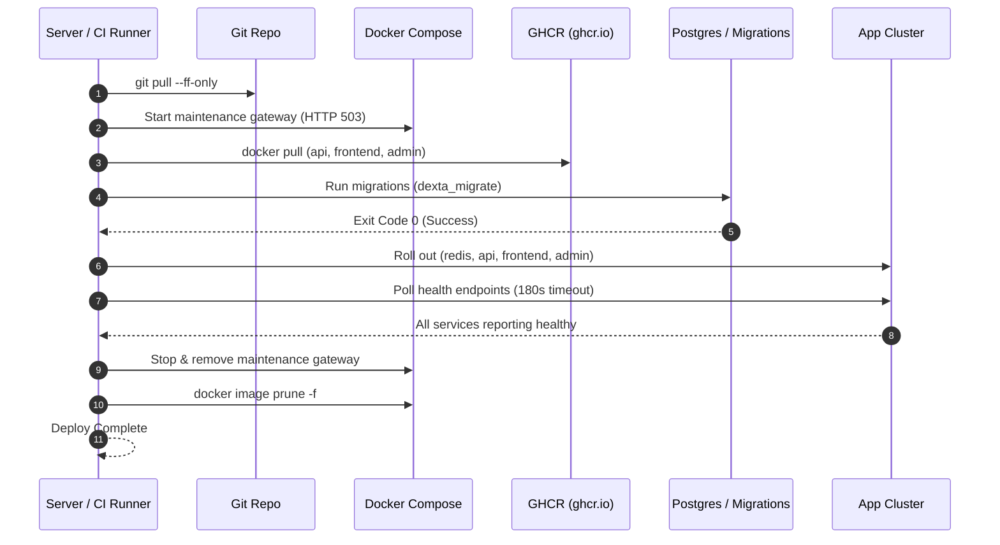

# Dexta Africa Enterprise Production Infrastructure & Deployment Engine

> **Production Standard**: Controlled Zero-Downtime Image-Pull Architecture with Ephemeral Database Migration Runner and Branded HTTP 503 Maintenance Gateway.

---

## 1. Architecture & Design Philosophy

This production environment strictly enforces **separation of concerns between CI (Artifact Generation) and CD (Cluster Execution)**:

1. **Zero Host Compilations**: The production host server never builds images, executes `npm run build`, compiles Go binaries, or stores source code and build tools. This prevents CPU/RAM spikes on production nodes and dramatically reduces the attack surface.
2. **Pre-Built OCI Image Pull**: Hardened, multi-stage, distroless images are built and vulnerability-scanned in GitHub Actions CI, pushed to **GitHub Container Registry (`ghcr.io/dextaafrica/*`)**, and tagged with both `:main` and `:sha-<commit>`.
3. **Controlled One-Shot Migration Job (`dexta_migrate`)**: Database schema migrations are executed by an ephemeral container with `--abort-on-container-exit` before web application containers start. If migrations fail, the deployment halts immediately without affecting active workloads.
4. **Automated Maintenance Gateway Overlay**: During schema migrations and critical updates, Traefik / Docker dynamically starts `dexta_maintenance` (serving HTTP 503 with auto-refresh every 30s) so visitors receive an executive-grade announcement rather than broken connections. Once health probes report healthy, the maintenance container is automatically stopped and removed.

---

## 2. Directory Structure

```tree
infra/prod/
├── docker-compose-prod.yml        # Production cluster definitions (redis, api, frontend, admin, migrate)
├── docker-compose-maintenance.yml # Ephemeral maintenance gateway overlay (HTTP 503)
├── Makefile                       # One-command orchestration engine
├── .env.prod.example              # Production environment template
├── .env.prod                      # Active production secrets (git-ignored)
├── maintenance/                   # Custom executive maintenance gateway
│   ├── Dockerfile                 # Minimal Alpine Nginx
│   ├── nginx.conf                 # 503 Service Unavailable + Retry-After: 30
│   └── index.html                 # Branded dark-mode telemetry page
└── README.md                      # This operational runbook
```

---

## 3. Deployment Pipeline Sequence (`make deploy`)

When you run `make deploy`, the engine executes the following automated sequence:



---

## 4. DevOps Command Reference

Run all commands from `infra/prod/` or `/home/server/apps/dextaafrica/infra/prod`:

| Command | Description |
| :--- | :--- |
| `make deploy` | **Full automated deployment** (pull git, maintenance on, pull images, migrate, rollout, health check, maintenance off, prune). |
| `make pull-images` | Manually pull the latest images from GitHub Container Registry. |
| `make run-migrations` | Execute database migrations manually via one-shot container. |
| `make maintenance-on` | Manually enable the HTTP 503 maintenance gateway. |
| `make maintenance-off` | Manually disable and remove the maintenance gateway. |
| `make status` | Inspect status, ports, and health probe states for all containers. |
| `make logs` | Stream consolidated live logs across all containers. |
| `make health` | Execute instant curl probes against API, Frontend, and Admin endpoints. |
| `make rollback tag=sha-XXXXXXX` | **Instant 1-command rollback** to any previous commit SHA or image tag. |

---

## 5. Rollback Procedure

If a deployed version introduces an unexpected business regression, roll back immediately with one command:

```bash
make rollback tag=sha-7f8e3d2
```

This updates `.env.prod` to pin `API_IMAGE`, `FRONTEND_IMAGE`, and `ADMIN_IMAGE` to that verified commit SHA, then safely rolls out the cluster through the standard zero-downtime pipeline.

---

## 6. Required Production Secrets

Ensure the following secrets are configured in `.env.prod`:

- `DATABASE_URL`: Connection string for PostgreSQL database.
- `REDIS_PASSWORD`: Secure authentication key for Redis cluster.
- `JWT_SECRET`: Minimum 32-character high-entropy secret for API authentication tokens.
- `ADMIN_APP_SECRET`: Session authentication secret for the Admin & Operations Portal.
- `API_IMAGE`: Container tag (`ghcr.io/dextaafrica/dexta-api:main`).
- `FRONTEND_IMAGE`: Container tag (`ghcr.io/dextaafrica/dexta-frontend:main`).
- `ADMIN_IMAGE`: Container tag (`ghcr.io/dextaafrica/dexta-admin:main`).
